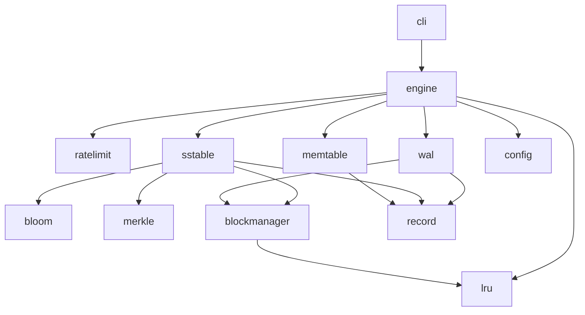
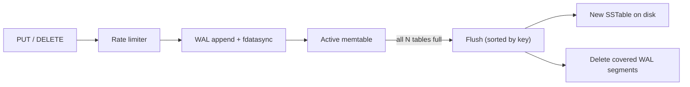

# kvengine

A persistent key-value storage engine written in Go. Data is written through a write-ahead log into an in-memory memtable, flushed to immutable sorted files on disk (SSTables), and read back through a layered read path with caching and Bloom filters. The engine is used through an interactive console menu.

> Course project (Advanced Algorithms and Data Structures, 2026/2027). Current scope: everything required for grade 8. Compaction and the LSM tree are out of scope for now (see [Roadmap](#roadmap)).

## Table of contents

1. [Features](#features)
2. [Quick start](#quick-start)
3. [Project layout](#project-layout)
4. [Architecture](#architecture)
5. [Record format](#record-format)
6. [Components](#components)
7. [On-disk layout](#on-disk-layout)
8. [Configuration](#configuration)
9. [Console menu](#console-menu)
10. [Testing](#testing)
11. [Status](#status)
12. [Open design decisions](#open-design-decisions)
13. [Roadmap](#roadmap)

## Features

- `PUT(key, value)`, `GET(key)`, `DELETE(key)` backed by a real write path and read path
- Segmented, block-based write-ahead log with CRC checks, fragmentation of large records, padding, trailing canary and `fdatasync`
- Memtable with pluggable implementation (hash map or skip list), optionally split into `N` instances
- SSTables made of Data, Filter (Bloom), Index, Summary (configurable sparsity) and Metadata (Merkle tree)
- Merkle-tree validation of any SSTable, started by the user
- LRU read cache and LRU block cache
- All file I/O goes through a block manager (4 KB, 8 KB or 16 KB blocks)
- Token-bucket rate limiting
- All settings come from an external JSON file, with defaults in code for anything missing

## Quick start

Requirements: Go 1.22 or newer.

```bash
git clone https://github.com/<your-team>/kvengine.git
cd kvengine

go build -o kvengine ./cmd/kvengine
./kvengine -config configs/config.json
```

If the config file or any single setting is missing, defaults from the code are used. Runtime data is written to `data/` (ignored by git).

## Project layout

```
kvengine/
├── cmd/
│   └── kvengine/
│       └── main.go              # entry point: load config, build engine, start menu
├── internal/
│   ├── config/                  # JSON loading, validation, default values
│   ├── record/                  # Record type + binary (de)serialization + CRC
│   ├── lru/                     # generic LRU cache (used by block cache and read cache)
│   ├── blockmanager/            # block read/write by (path, block number) + block cache
│   ├── wal/                     # segmented write-ahead log, recovery
│   │   ├── sync_linux.go        #   fdatasync (build tag: linux)
│   │   └── sync_other.go        #   Sync() fallback for other platforms
│   ├── memtable/                # Memtable interface + hashmap.go + skiplist.go
│   ├── bloom/                   # Bloom filter
│   ├── merkle/                  # Merkle tree build + validation
│   ├── sstable/                 # writer, reader, data, index, summary, filter, metadata
│   ├── ratelimit/               # token bucket
│   ├── engine/                  # orchestrates write path and read path
│   └── cli/                     # interactive console menu
├── configs/
│   └── config.json              # example configuration
├── docs/                        # diagrams, design notes
├── data/                        # runtime data (gitignored)
├── go.mod
└── README.md
```

Each package maps to one component of the specification. Dependencies only point in one direction, so every layer can be developed and tested on its own:



`internal/` keeps everything private to the module. `cmd/` stays thin. `engine` knows nothing about the console, so it can be tested without it.

## Architecture

### Write path



1. The request passes the token bucket.
2. The operation is appended to the WAL and synced to disk.
3. Only after the WAL confirms the write, it is applied to the active memtable. A `DELETE` writes a record with the tombstone flag set.
4. With `N` memtables, one is read-write and `N-1` are read-only. When the active one is full it becomes read-only and a fresh one takes over. When all `N` are full, they are flushed to a new SSTable.
5. WAL segments are removed only when everything they contain is persisted in an SSTable.

### Read path


1. Memtables, newest to oldest. A hit, including a tombstone, ends the search.
2. Read cache. A hit ends the search.
3. SSTables, newest to oldest. For each one: Bloom filter, then Summary range (min/max key), then Index, then Data. A tombstone means "not found".
4. A value found on disk is put into the read cache. `PUT` and `DELETE` update or invalidate the cached entry so the cache never serves stale data.

## Record format

The same logical record is used in the WAL and in SSTable Data.

```
+-----------+----------------+--------------+----------------+------------------+-----+-------+
| CRC (4B)  | Timestamp (16B)| Tombstone(1B)| Key Size (8B)  | Value Size (8B)  | Key | Value |
+-----------+----------------+--------------+----------------+------------------+-----+-------+
```

| Field | Offset | Size | Description |
|---|---|---|---|
| CRC | 0 | 4 B | CRC32 (IEEE, `hash/crc32`) over every byte after this field, from Timestamp to the end of Value |
| Timestamp | 4 | 16 B | Time of the operation in Unix seconds, as a little-endian `uint64` in the first 8 bytes. The remaining 8 bytes are reserved and set to zero |
| Tombstone | 20 | 1 B | `0` = live record, `1` = deleted. A deleted record has Value Size `0` and no value bytes |
| Key Size | 21 | 8 B | Length of Key in bytes (`uint64`) |
| Value Size | 29 | 8 B | Length of Value in bytes (`uint64`) |
| Key | 37 | Key Size | Key as UTF-8 bytes |
| Value | 37 + Key Size | Value Size | Raw bytes. The console accepts values as strings and converts them to bytes |

- All numeric fields are **little-endian**.
- The fixed header is $4 + 16 + 1 + 8 + 8 = 37$ bytes.
- Serialization uses only `encoding/binary` and `hash/crc32`. No serialization libraries are used.
- On read, the CRC is recomputed and compared. A mismatch marks the record as corrupted.

## Components

### Block manager and block cache

All reads and writes of files go through the block manager, never directly through `os.File`.

- The disk is divided into fixed-size blocks (4 KB, 8 KB or 16 KB, set in the config).
- Read: `(path, blockNumber)`. The block cache is checked first, and only on a miss is the block read from disk and added to the cache.
- Write: `(path, blockNumber, content)`. The block is written to disk, and if it is in the cache, the cached copy is updated too.
- The block cache uses LRU eviction and its size is configurable.
- A reader/writer wrapper on top of the block manager lets higher layers treat a file as a byte stream, since a record can cross block boundaries.

### Write-ahead log (WAL)

- Append-only, split into segments of a fixed size given in blocks.
- A record larger than the free space in the current block is fragmented across blocks. Padding is applied where a block cannot be filled.
- Each record ends with a trailing canary field.
- Content is flushed to disk with `fdatasync` (`syscall.Fdatasync` on Linux, `File.Sync()` elsewhere, selected by build tags).
- Records are read one by one, never by loading a whole segment into memory. The CRC is checked on every record.
- On startup the WAL is replayed in order to rebuild the memtable(s).
- A segment is deleted only after all of its data is persisted in an SSTable.

### Memtable

- A common interface: add/update, logical delete (tombstone), find, and sorted iteration for flush.
- Implementations: **hash map** and **skip list**, selected in the config. The hash map sorts keys at flush time. The skip list is already ordered.
- The size limit is configured as a number of elements or as memory in KB.
- `N` instances can be kept in memory: `N-1` read-only and one read-write. A flush happens when all `N` are full.

### SSTable

An SSTable is a directory of files:

| File | Content |
|---|---|
| Data | Records sorted by key. Never loaded whole, read block by block |
| Filter | Bloom filter over all keys in Data |
| Index | Key and offset into Data for every record. Read block by block |
| Summary | Min key and max key of the Index, plus every $k$-th Index entry (key and offset into Index). $k$ is the configurable sparsity. Read block by block |
| Metadata | Merkle tree over all values in Data |

**Lookup:** Bloom filter says "maybe". Check that the key is within the Summary range. Find the Index position from Summary. Find the Data offset in the Index. Read the record.

**Bloom filter sizing.** For $n$ expected keys and false-positive rate $p$, the number of bits $m$ and hash functions $k$ are

$$m = -\frac{n \ln p}{(\ln 2)^2}, \qquad k = \frac{m}{n}\ln 2 .$$

**Merkle validation.** The user selects an SSTable. The engine rebuilds the tree from the current Data file and compares it with the stored one, reporting whether and where the data was changed.

### Read cache

LRU cache of `key -> record` with a configurable maximum size. It sits between the memtables and the SSTables and is updated on every `PUT` and `DELETE`.

### Rate limiting

Token bucket with configurable token count and refill interval. Its state is serialized and stored in the engine like any other record, under a reserved key. The user cannot read, write or delete it through the normal operations.

## On-disk layout

```
data/
├── wal/
│   ├── wal_000001.log
│   └── wal_000002.log
└── sstable/
    ├── sst_L0_000001/
    │   ├── data.db
    │   ├── index.db
    │   ├── summary.db
    │   ├── filter.db
    │   └── metadata.db
    └── sst_L0_000002/
```

The `L0` in the name reserves the level for the future LSM tree, so files will not need renaming later.

## Configuration

All settings live in one JSON file. Any missing setting falls back to the default from the code.

```json
{
  "data_dir": "data",
  "block_size": 4096,
  "block_cache_blocks": 256,
  "wal_segment_blocks": 16,
  "memtable_type": "skiplist",
  "memtable_max_entries": 1000,
  "memtable_max_kb": 0,
  "memtable_count": 1,
  "summary_sparsity": 5,
  "bloom_false_positive_rate": 0.01,
  "read_cache_entries": 1000,
  "rate_limit_tokens": 100,
  "rate_limit_interval_seconds": 60
}
```

| Key | Meaning | Allowed values |
|---|---|---|
| `block_size` | Block size in bytes | 4096, 8192, 16384 |
| `block_cache_blocks` | Block cache capacity (blocks) | > 0 |
| `wal_segment_blocks` | WAL segment size in blocks | > 0 |
| `memtable_type` | Memtable implementation | `hashmap`, `skiplist` |
| `memtable_max_entries` | Memtable limit by element count | > 0 |
| `memtable_max_kb` | Memtable limit by memory. `0` = use element count | >= 0 |
| `memtable_count` | Number of memtables `N` | >= 1 |
| `summary_sparsity` | Every $k$-th Index entry goes to Summary | >= 1 |
| `bloom_false_positive_rate` | Target Bloom false-positive rate $p$ | $0 < p < 1$ |
| `read_cache_entries` | Read cache capacity (records) | > 0 |
| `rate_limit_tokens` | Bucket size | > 0 |
| `rate_limit_interval_seconds` | Refill interval | > 0 |

The configuration is validated at startup, and invalid values stop the program with a clear message.

## Console menu

```
1) PUT
2) GET
3) DELETE
4) Validate SSTable (Merkle tree)
5) Exit
```

Keys are strings. Values are entered as strings and converted to bytes by the engine.

## Testing

```bash
go vet ./...
go test ./...
```

Every package has its own `_test.go` files. Important cases:

- record round-trip, corrupted CRC, empty value, tombstone
- WAL: many records over several segments, fragmented records, a damaged tail, replay after a restart
- block manager: cache hit on the second read, cache update on write
- SSTable: lookup through Summary, Index and Data, missing keys, tombstones
- engine: `PUT`, restart, `GET`, including after a flush

## Development workflow & conventions

To keep the codebase clean and maintainable, please follow these branching, commit, and coding conventions while working on the project.

### 1. Branching strategy
We use feature and fix branches branching off from `main`. Keep pull requests scoped to a single logical change.

* **Feature branches:** `feature/<short-description>` (e.g., `feature/skiplist-memtable`, `feature/bloom-filter`)
* **Bug fixes:** `fix/<short-description>` (e.g., `fix/wal-crc-checksum`, `fix/sstable-reader-offset`)

Never push directly to `main`. Open a pull request once your implementation and local tests are ready.

### 2. Commit conventions
* **How often to commit:** Commit early and often. Make a commit whenever you complete a logical, working, and tested step (e.g., after writing a specific function, fixing a bug, or adding a unit test). Avoid large, monolithic commits that bundle unrelated changes.
* **Rule of thumb:** One commit should represent a single, self-contained change that leaves the codebase in a stable state. Never commit broken code or failing tests to a feature branch unless it is explicitly marked as a temporary Work In Progress (`WIP`).

We follow conventional commit guidelines to keep the Git history readable and structured. Each commit message must follow this format:

~~~~text
<type>(<scope>): <short summary>
~~~~

**Allowed types:**
* `feat`: Adding a new feature or component (e.g., `feat(wal): implement block-based segment rotation`)
* `fix`: Fixing a bug (e.g., `fix(blockmanager): handle out-of-bounds block index read`)
* `refactor`: Code change that neither fixes a bug nor adds a feature (e.g., `refactor(sstable): clean up summary index search logic`)
* `test`: Adding or updating tests (e.g., `test(memtable): add concurrent skip list unit tests`)
* `docs`: Documentation updates (e.g., `docs(readme): update project layout tree`)
* `chore`: Maintenance tasks, dependencies, or tooling (e.g., `chore: update go version`)

**Examples of good commits:**
~~~~bash
git commit -m "feat(merkle): implement tree generation for sstable metadata"
git commit -m "fix(engine): resolve get path race condition on memtable flush"
~~~~

### 4. Issue tracking & management
We use GitHub Issues to track bugs, plan upcoming features, and discuss design decisions. Keeping issues organized helps track progress across components.

* **When to open an issue:**
  * **Bug Reports:** When you encounter unexpected behavior, data corruption, or panic during testing or normal execution.
  * **Feature Proposals:** Before starting a complex new module (e.g., adding compaction or LSM tree layers), open an issue to outline the design.
  * **Task Breakdown:** For splitting larger coursework requirements into manageable sub-tasks.

* **How to write a good issue:**
  * **Clear Title:** Use a descriptive title prefixed with the component or scope (e.g., `[WAL] Segment rotation fails when block boundary is exactly reached` or `[SSTable] Design Merkle tree validation flow`).
  * **Description/Context:** Provide steps to reproduce for bugs, or a clear specification/proposal for new features.
  * **Linking PRs:** Reference the issue number in your pull request description (e.g., `Closes #12` or `Relates to #8`) so they automatically link and close upon merging.

### 4. Go coding conventions & project standards
* **Error handling:** Never ignore errors using `_`. Always handle them explicitly, wrap them with context using `fmt.Errorf("...: %w", err)` where appropriate, and return them up the stack.
* **File I/O & Block alignment:** All file operations must go through the block manager using fixed-size blocks (4KB, 8KB, or 16KB). Avoid direct unbuffered reads/writes outside designated components.
* **Concurrency:** Ensure components shared across read and write paths (such as the memtable, cache, or block manager) are thread-safe and properly guarded using sync primitives (`sync.RWMutex`, `sync.Mutex`).
* **Configuration:** Do not hardcode magic numbers, paths, or limits. Fetch settings dynamically from the loaded configuration struct, falling back to safe defaults if fields are missing.
* **Testing:** Every new module or significant change should include corresponding unit tests under the same package or in a `_test.go` file. Run tests locally before opening a PR:
  ~~~~bash
  go test ./... -v
  ~~~~

## Status

**Grade 6**
- [ ] Config (2.1)
- [ ] Record
- [ ] Block manager and block cache (1.6)
- [ ] WAL (1.1)
- [ ] Memtable, hash map (1.2)
- [ ] SSTable: Data, Filter, Index, Summary (1.3, without 1.3.5)
- [ ] Engine write path and read path, console menu

**Grade 7**
- [ ] Merkle tree metadata and validation (1.3.5)
- [ ] LRU read cache (1.5)
- [ ] Skip list memtable (1.2[DZ1])
- [ ] Configurable Summary sparsity (1.3[DZ1])

**Grade 8**
- [ ] Token bucket (2.2)
- [ ] WAL with block-sized segments, fragmentation, padding, canary, `fdatasync` (1.1[DZ1])
- [ ] `N` memtables (1.2[DZ2])

## Open design decisions

These follow the course material and should be confirmed:

- Exact WAL fragment header and the canary value.
- Whether a fragmented record may cross a segment boundary.
- Whether SSTable components stay as separate files (current choice) or become one file.
- Hash function for the Merkle tree.
- With `N` memtables, whether all of them are flushed together into one SSTable (current choice) or one at a time.

## Roadmap

Beyond the current scope: LSM tree with size-tiered and leveled compaction, snapshots and checkpoints, prefix and range scans, iterators, SSTable compression (variable-length and delta encoding), data block hash index, MANIFEST and recovery, backups, probabilistic types (Bloom filter, Count-Min Sketch, HyperLogLog, SimHash), batch operations, TTL, BLOBs and keyspaces.
